<!-- ═══════════════ HEADER ═══════════════ -->


<div align="center">


<br/>

<a href="https://koorumahey.com"></a>
<a href="https://linkedin.com/in/koorumahey"></a>
<a href="https://github.com/koorumahey"></a>


</div>

<br/>

<!-- ═══════════════ CODEVERSE ORBIT ═══════════════ -->
<p align="center">
  
</p>

<p align="center"><i>"Knowledge empowers minds, and minds build the future."</i></p>

---

## `$ ros2 run codeverse whoami`

```python
#!/usr/bin/env python3
import rclpy
from rclpy.node import Node


class KooruMahey(Node):
    def __init__(self):
        super().__init__("kooru_mahey")
        self.role      = ["AI Developer", "Aspiring Robotics Engineer", "Full Stack Dev"]
        self.building  = ["TT2DNN", "Knowledge Minds Scheduler",
                          "PondiMediTourism", "BookYourSlots"]
        self.exploring = ["ROS2", "Reinforcement Learning", "LLM Systems", "AI Research"]
        self.mission   = "Solve real-world problems with intelligent systems"
        self.create_timer(1.0, self.loop)

    def loop(self):
        for phase in ["BUILD", "LEARN", "EXPLORE", "IMPACT"]:
            self.get_logger().info(f"[{phase}] one project at a time...")


def main():
    rclpy.init()
    rclpy.spin(KooruMahey())   # never stops building
```

---

## 🛰️ Mission Control

<table>
<tr>
<td width="50%" valign="top">

### 🔨 Building
`TT2DNN` · `Knowledge Minds Scheduler`<br/>
`PondiMediTourism` · `BookYourSlots`

</td>
<td width="50%" valign="top">

### 🔭 Exploring
`ROS & ROS2` · `Reinforcement Learning`<br/>
`LLM Systems` · `AI Research`

</td>
</tr>
</table>

```text
 TRAINING LOG ─────────────────────────────────────────────
 Deep Learning          ████████████████░░░░   80%   ▲
 Full Stack Dev         ██████████████████░░   90%   ▲
 ROS2                   ██████████░░░░░░░░░░   50%   ▲
 Reinforcement Learning ████████░░░░░░░░░░░░   40%   ▲
 LLM Architecture       █████████░░░░░░░░░░░   45%   ▲
 AI Systems Design      ███████████░░░░░░░░░   55%   ▲
 ──────────────────────────────────────────────────────────
 status: learning... epoch ∞
```

---

## ⚙️ Tech Arsenal

<div align="center">

| Domain | Stack |
|:--:|:--:|
| **Languages** |  |
| **Frontend** |  |
| **Backend** |  |
| **AI • Data** |  |
| **Robotics • Tools** |  |

</div>

---

## 🚀 Featured Projects

<table>
<tr>
<td width="50%" valign="top">

### 🧠 TT2DNN
AI-powered university timetable generator using Deep Neural Networks.


</td>
<td width="50%" valign="top">

### 📅 Knowledge Minds Scheduler
Automated academic scheduling platform.


</td>
</tr>
<tr>
<td width="50%" valign="top">

### 🏥 PondiMediTourism
Medical tourism platform for Puducherry.


</td>
<td width="50%" valign="top">

### 🩺 BookYourSlots
Healthcare appointment platform.


</td>
</tr>
</table>

---

## 📡 Telemetry

<div align="center">


</div>

---

## 🌌 Contribution Universe


<p align="center">
  <picture>
    <source media="(prefers-color-scheme: dark)" srcset="https://raw.githubusercontent.com/koorumahey/koorumahey/output/github-snake-dark.svg" />
    
  </picture>
</p>

---

## 🧭 Vision

> **Building intelligent technology that bridges research and real-world impact.**
>
> AI. Robotics. Full Stack. Autonomous systems.<br/>
> **One project at a time.**

```text
   Small Steps.
   Build Big Worlds.

   BUILD  <  LEARN  <  EXPLORE  <  IMPACT
```

<div align="center">

### ⚡ Thalaivar Nerantharam ⚡

</div>

<!-- ═══════════════ FOOTER ═══════════════ -->

