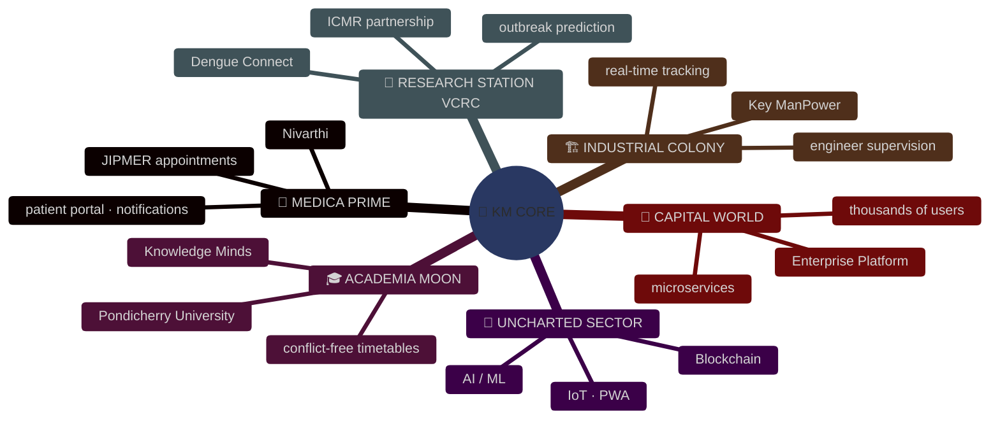
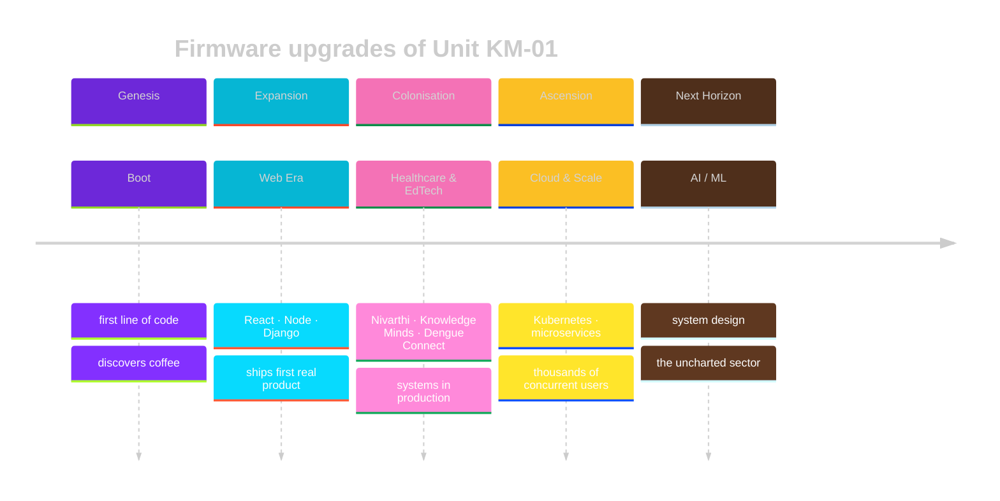

<!-- ═══════════════════════════════════════════════════════════════════
     KM UNIVERSE — GitHub Profile README
     Concept: you are an AI android (Unit KM-01) and your projects are
     the planets of a galaxy you built. Mission-control HUD styling.
     ═══════════════════════════════════════════════════════════════════ -->

<div align="center">


<br>


<br><br>

<a href="https://git.io/typing-svg">
  
</a>

</div>

<br>

<!-- ───────────────────────────── UNIT PROFILE ───────────────────────────── -->

<div align="center">

## ◈ UNIT PROFILE

</div>

<table>
<tr>
<td width="40%" valign="top" align="center">

```text
         ╭───────────────╮
         │  ◉       ◉    │
         │       ▽       │
         │   ╰───────╯   │
         ╰───────┬───────╯
        ╭────────┴────────╮
        │  ▐█▌ KM-01 ▐█▌  │
        │   ▓▓▓▓▓▓▓▓▓▓▓   │
   ╭────┤   ░░ CORE ░░   ├────╮
   │    │   ▓▓▓▓▓▓▓▓▓▓▓   │    │
  ╭┴╮   ╰────────┬────────╯   ╭┴╮
  ╰─╯        ╭───┴───╮        ╰─╯
             │ █   █ │
             ╰─╯   ╰─╯
```


</td>
<td width="60%" valign="top">

```jsonc
{
  "designation":   "KM-01",
  "alias":         "Kooru Mahey",
  "class":         "Full Stack Android",
  "assembled_in":  "Puducherry, India 🇮🇳",
  "home_base":     "https://koorumahey.com",

  "power_source":  "coffee + curiosity",
  "sleep_mode":    "debugs in dreams",

  "active_protocols": [
    "building healthcare & education systems",
    "mastering cloud architecture at scale",
    "exploring AI/ML and modern web tech",
    "learning advanced system design"
  ],

  "known_glitch":  "occasionally turns bugs into features",
  "threat_level":  "friendly (unless you use tabs)"
}
```

</td>
</tr>
</table>

<br>

<!-- ───────────────────────────── NEURAL MODULES ───────────────────────────── -->

<div align="center">

## ◈ NEURAL MODULES INSTALLED

<sub>Each module is a region of the KM-01 brain. Power draw shown per sector.</sub>

<br><br>

<table>
<tr>
<td align="center" width="20%">
<b>🧠 CORTEX</b><br><sub>languages</sub><br><br>

<br><br><code>████████░░ 87%</code>
</td>
<td align="center" width="20%">
<b>👁️ OPTIC ARRAY</b><br><sub>frontend</sub><br><br>

<br><br><code>█████████░ 92%</code>
</td>
<td align="center" width="20%">
<b>⚙️ MOTOR SYSTEM</b><br><sub>backend</sub><br><br>

<br><br><code>█████████░ 90%</code>
</td>
<td align="center" width="20%">
<b>💾 MEMORY BANKS</b><br><sub>databases</sub><br><br>

<br><br><code>████████░░ 85%</code>
</td>
<td align="center" width="20%">
<b>🛰️ ORBITAL LINK</b><br><sub>cloud & devops</sub><br><br>

<br><br><code>████████░░ 83%</code>
</td>
</tr>
</table>

<br>


<br><sub>🔧 AUXILIARY TOOLING</sub>

</div>

<br>

<!-- ───────────────────────────── GALAXY MAP ───────────────────────────── -->

<div align="center">

## ◈ THE KM GALAXY — PLANETARY SYSTEMS

<sub>Every project is a world. Every world orbits the core.</sub>

</div>



<br>

<table>
<tr>
<td width="50%" valign="top">

### 🏥 MEDICA PRIME &nbsp;·&nbsp; `Nivarthi`
 

A hospital world where appointments book themselves. Integrated scheduling, patient record management, SMS/Email alerts and role-based access.

`Healthcare Tech` `Real-time Booking` `Patient Portal`

[⟶ Enter system](#) · [⟶ Star charts (docs)](#)

</td>
<td width="50%" valign="top">

### 🎓 ACADEMIA MOON &nbsp;·&nbsp; `Knowledge Minds`
 

A moon of scholars, freed from timetable wars. Intelligent conflict-free scheduling, faculty & student portals, resource optimisation algorithms.

`EdTech` `Smart Scheduling` `Algorithms`

[⟶ Enter system](#) · [⟶ University portal](#)

</td>
</tr>
<tr>
<td width="50%" valign="top">

### 🔬 RESEARCH STATION &nbsp;·&nbsp; `Dengue Connect`
 

A surveillance outpost watching for outbreaks. Real-time disease tracking, research data collection and prediction models, built with ICMR VCRC and Pondicherry University.

`Public Health` `Data Analytics` `Prediction`

[⟶ Research portal](#) · [⟶ Data dashboard](#)

</td>
<td width="50%" valign="top">

### 🏗️ INDUSTRIAL COLONY &nbsp;·&nbsp; `Key ManPower`
 

Where engineers are deployed like fleets. Live tracking & allocation, automated project assignment, performance analytics, mobile-first supervision.

`Workforce Mgmt` `Real-time` `Analytics`

[⟶ Platform](#) · [⟶ Analytics](#)

</td>
</tr>
<tr>
<td width="50%" valign="top">

### 🌆 CAPITAL WORLD &nbsp;·&nbsp; `Enterprise Platform`
 

The busiest planet in the galaxy. Microservices, cloud infrastructure, advanced caching and a continuous deployment pipeline serving thousands of concurrent users.

`Microservices` `Scalability` `CI/CD`

[⟶ Project](#) · [⟶ Case study](#)

</td>
<td width="50%" valign="top">

### 🚀 UNCHARTED SECTOR &nbsp;·&nbsp; `classified`


Probes have been launched. Early signals suggest AI/ML integrations, blockchain applications, IoT solutions and progressive web apps.

`R&D` `Experimental`

[⟶ Telescope (all repos)](https://github.com/KOORUMAHEY?tab=repositories)

</td>
</tr>
</table>

<br>

<!-- ───────────────────────────── TELEMETRY ───────────────────────────── -->

<div align="center">

## ◈ LIVE TELEMETRY


<br><br>


<br><br>


<br><br>

<details>
<summary>◈ DECORATIONS EARNED</summary>
<br>

</details>

</div>

<br>

<!-- ───────────────────────────── EVOLUTION ───────────────────────────── -->

<div align="center">

## ◈ EVOLUTION TIMELINE

</div>



<br>

<!-- ───────────────────────────── RECHARGE ───────────────────────────── -->

<div align="center">

## ◈ RECHARGE PROTOCOLS

<sub>When the core idles, these subroutines run.</sub>

<br><br>

| 🎸 AUDIO SUBROUTINE | 🎮 SIMULATION MODE | ✈️ EXPLORATION DRIVE | ☕ FUEL INTAKE | 🏏 TRIBAL RITUAL |
|:---:|:---:|:---:|:---:|:---:|
| music enthusiast | gamer | solo travel | coffee connoisseur | cricket fan |
| `▓▓▓▓▓▓▓▓░░` | `▓▓▓▓▓▓▓░░░` | `▓▓▓▓▓▓▓▓▓░` | `▓▓▓▓▓▓▓▓▓▓` | `▓▓▓▓▓▓▓▓░░` |

</div>

<br>

<!-- ───────────────────────────── COMMS ───────────────────────────── -->

<div align="center">

## ◈ COMMUNICATION ARRAY

<a href="https://koorumahey.com"></a>
<a href="https://linkedin.com/in/kooru-mahey"></a>
<a href="https://twitter.com/_KooruMahey_"></a>
<a href="https://leetcode.com/u/KOORUMAHEY/"></a>

<br><br>

**ACCEPTING TRANSMISSIONS FOR:**

`💼 Freelance missions` · `🤝 Joint expeditions` · `💡 New star systems` · `🎓 Cadet training` · `🏥 Healthcare tech` · `📚 EdTech`

</div>

<br>

<!-- ───────────────────────────── DIRECTIVE ───────────────────────────── -->

<div align="center">

## ◈ PRIME DIRECTIVE

```text
╔══════════════════════════════════════════════════════╗
║                                                      ║
║   "Coding is an Art. And KM is the Artist."          ║
║                                                      ║
║   Directive 01 — Build things that help humans.      ║
║   Directive 02 — Ship it, then make it beautiful.    ║
║   Directive 03 — Never run out of coffee.            ║
║                                                      ║
╚══════════════════════════════════════════════════════╝
```

<br>

<sub>⟡ You have reached the edge of the known KM Universe ⟡</sub>
<br>
<sub>Star a repository to leave a beacon for the next traveller ⭐</sub>

<br><br>


</div>
