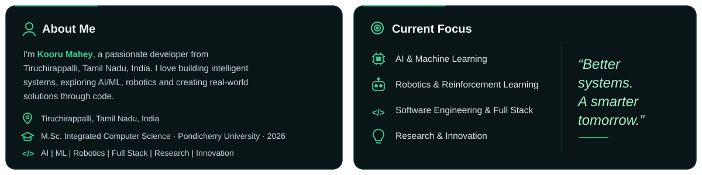
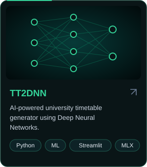
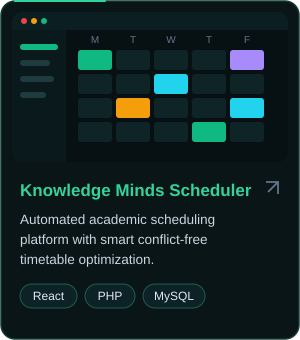
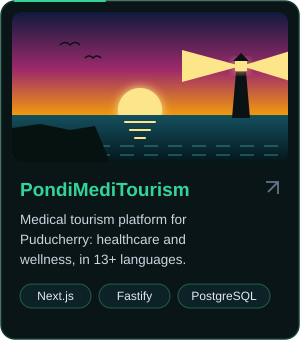
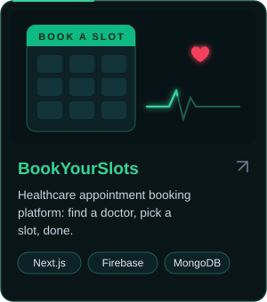
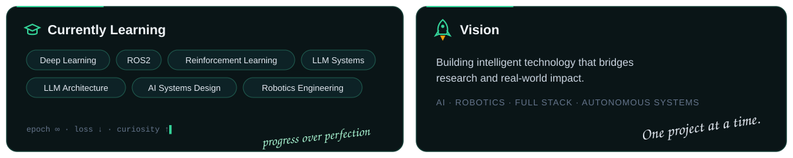

  

 

 

<table>
<tr>
<td width="50%" valign="top">

<h3>⚙️ Tech Arsenal</h3>

<b>Languages</b> 
  
<b>Frontend</b> 
  
<b>Backend</b> 
  
<b>AI • Data</b> 
  
<b>Robotics • Tools</b> 

</td>
<td width="50%" valign="top">

<h3>📊 GitHub Stats</h3>

</td>
</tr>
</table>

  <picture>
    <source media="(prefers-color-scheme: dark)" srcset="https://raw.githubusercontent.com/koorumahey/koorumahey/output/github-snake-dark.svg"/>
    
  </picture>

